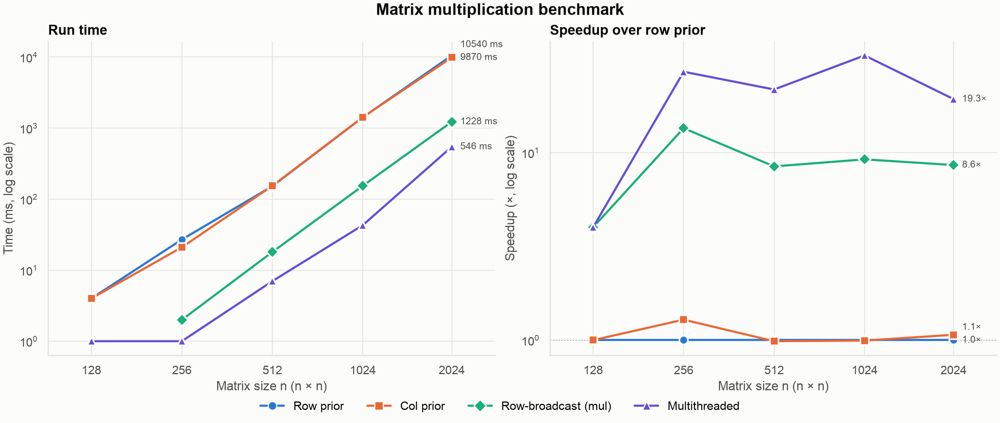

# matrix_comp

Benchmarks different ways of multiplying dense square matrices in C++20.



## Algorithms

All variants compute `out = m1 * m2` on row-major `Matrix<T>` storage and are configured through a single `mul_cfg<T>`.

| Function | Loop order | Idea |
|---|---|---|
| `mul_row_prior` | `i → j → k` | Fills `out` row by row; reads `m2` down a column (strided, cache-unfriendly). |
| `mul_col_prior` | `j → i → k` | Fills `out` column by column; same strided access to `m2`. |
| `mul` (row-broadcast) | `i → k → j` | Multiplies `m1[i][k]` by the whole row `k` of `m2` and adds it to row `i` of `out`. All inner reads are sequential. |
| `mul_multithread` | `i → k → j`, one thread per row | Same as `mul`, with each output row computed on its own thread. |

### Threads in `mul_cfg`

`mul_cfg` creates its worker threads in the constructor, one per row of `m1`. Each thread waits on a `std::latch` until `mul_multithread` releases them, so thread creation is not part of the timed region. Consequences:

- `mul_multithread` can run **once** per `mul_cfg`; a second call throws `std::logic_error`.
- `mul_cfg` is non-copyable, because the threads hold a pointer to it.
- If `mul_multithread` is never called, the destructor wakes the threads, which then exit without doing any work.

## Results

Apple Silicon (arm64), `-O3 -march=native`, `double`, times in ms:

| n | Row prior | Col prior | Row-broadcast | Multithreaded |
|---:|---:|---:|---:|---:|
| 128 | 4 | 4 | 0 | 1 |
| 256 | 27 | 21 | 2 | 1 |
| 512 | 152 | 154 | 18 | 7 |
| 1024 | 1418 | 1426 | 154 | 43 |
| 2024 | 10540 | 9870 | 1228 | 546 |

At n = 2024, changing only the loop order (`mul`) is about 8.5× faster than row prior. Adding threads brings it to about 19×.

> Timings use millisecond resolution, so runs under ~5 ms are mostly rounding noise. A 0 ms result cannot be drawn on the log-scale run-time plot; that is why the 128 point for row-broadcast is missing.

## Project layout

```
include/
  matrix.hpp         Matrix<T>, print_matrix, mul_cfg, all multiplication variants
  benchmark.hpp      bench_matrix_mul: times every variant on one mul_cfg
  results_json.hpp   save_results_json: writes results to JSON
src/benchmark.cpp    mes_time timer
main.cpp             2×2 sanity check + benchmark over several sizes
scripts/             uv project for parsing and plotting the results
results/             benchmark output (results.json)
assets/              generated plots (results.png)
```

## Build and run

Requires CMake ≥ 3.15 and a C++20 compiler (uses `std::latch`).

```sh
cmake -S . -B build -DCMAKE_BUILD_TYPE=Release
cmake --build build
./build/matrix_comp
```

Run it from the project root: the binary writes `results/results.json` relative to the current directory.

Every target compiles with `-O3`, plus `-march=native` when the compiler supports it.

A `conanfile.py` is also provided (`conan build .`).

## Plotting

The Python scripts are a [uv](https://docs.astral.sh/uv/) project; `uv.lock` pins pandas, seaborn and matplotlib.

```sh
cd scripts
uv run parse_results.py     # print the results as a table
uv run plot_results.py      # write assets/results.png
```

`plot_results.py` options:

| Option | Meaning |
|---|---|
| `json` (positional) | Input file, default `results/results.json` |
| `-o`, `--out` | Output image, default `assets/results.png` |
| `--show` | Also open an interactive window |

The figure has two panels, run time and speedup over row prior, both with log-scale axes. Each algorithm keeps a fixed, colorblind-safe color and marker in both panels.

## JSON format

```json
{
  "unit": "ms",
  "results": [
    {"n": 128, "row_prior_mul": 4, "col_prior_mul": 4, "multithread_mul": 1, "mul": 0}
  ]
}
```

## Known limitations

- **No reset between runs.** The variants do not zero `out` before accumulating, and `bench_matrix_mul` runs them all on the same `out`. Timings are valid, but `out` does not hold the correct product afterwards.
- **One thread per row.** At n = 2024 that is 2024 threads. Splitting rows across `std::thread::hardware_concurrency()` threads should be faster.
- **Millisecond timer.** Small sizes round to 0–2 ms.
